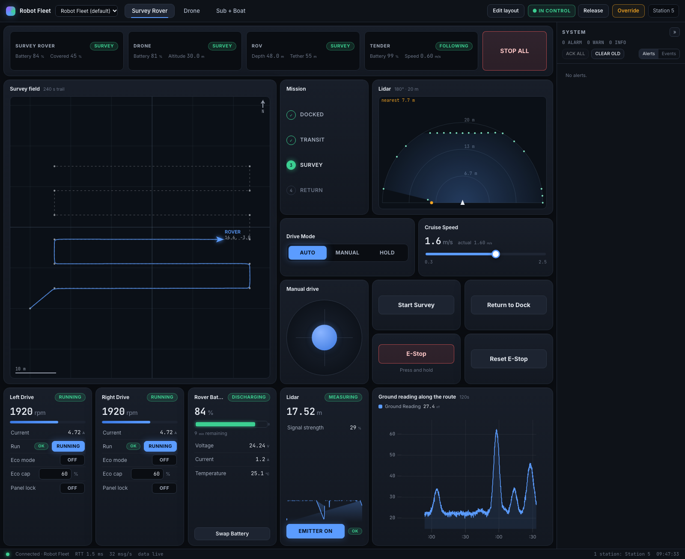
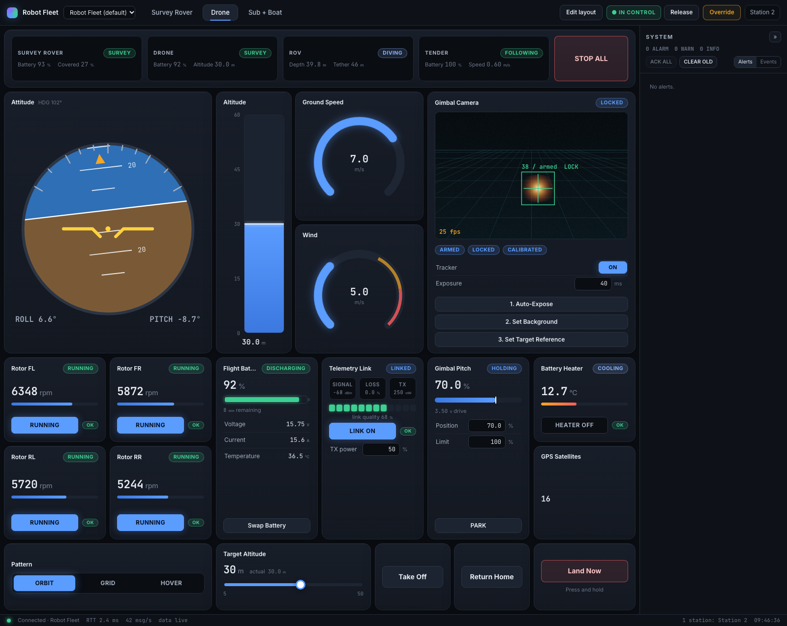
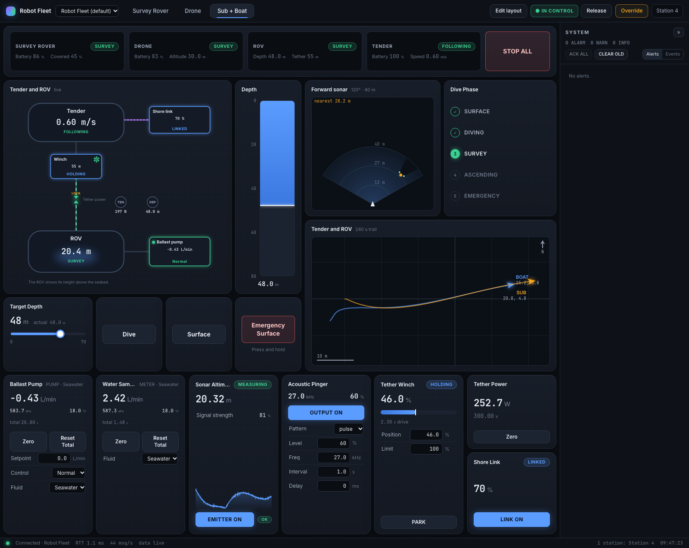
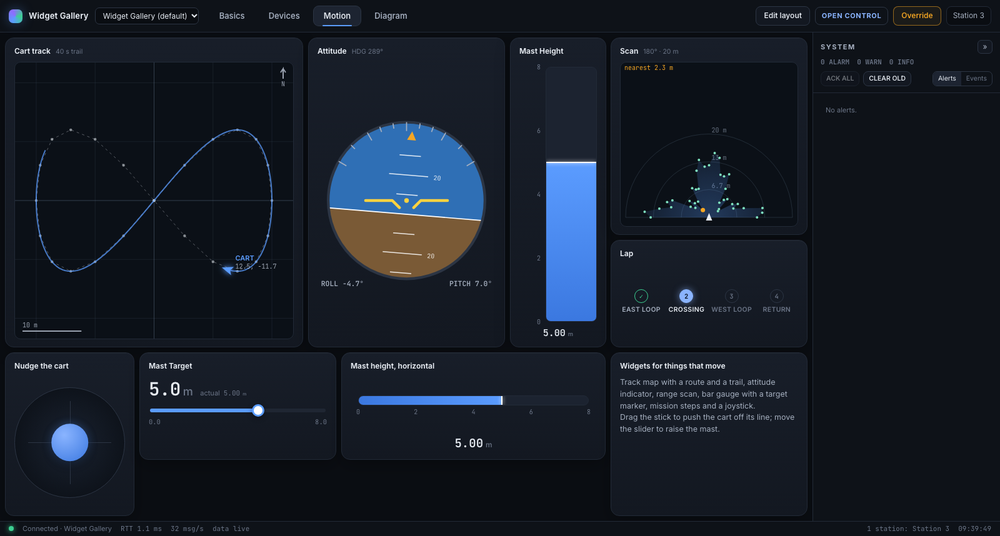
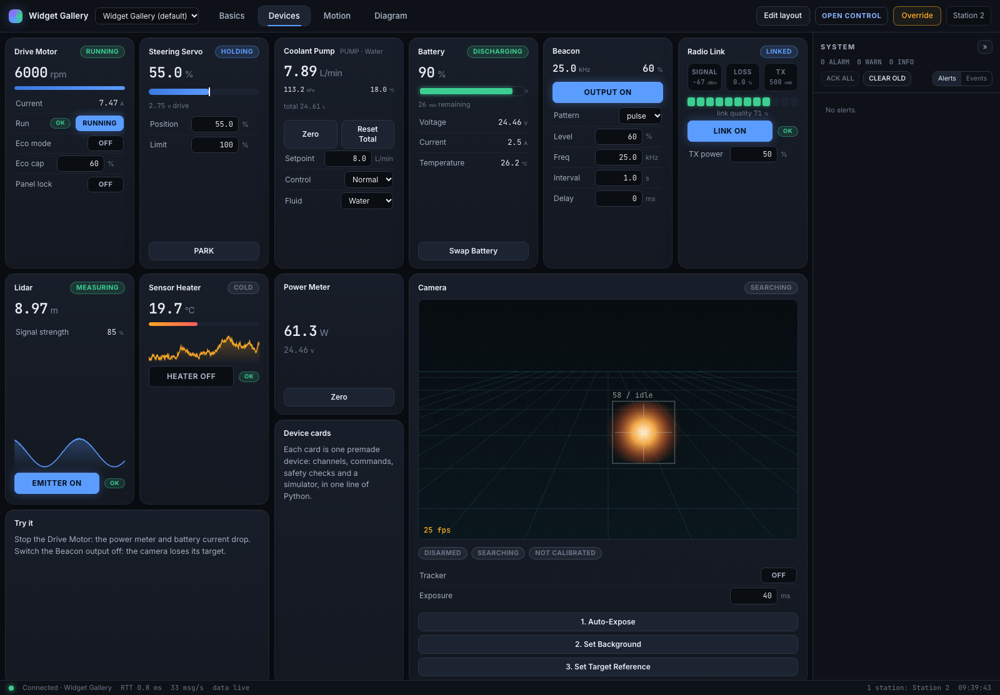

# NexusUI

A visual way to monitor and control hardware and IoT I/O, written in Python.

You describe your devices as named values in Python. NexusUI gives you the screen: readouts, gauges, switches, sliders, trends and alarms, in its own window or in any browser, on one computer or on several at once. Think of what Grafana does for metrics, with controls as well as charts, for your own hardware.



- **No UI code.** Declare channels and devices in Python, then place ready-made widgets by drag and drop. Layouts are saved as JSON next to the app.
- **Runs as its own app.** `python app.py` opens a standalone window, private to your computer, with nothing to type into a browser. Add `--browser` and the same UI is served to any browser on your network.
- **Several screens at once.** Started with `--browser`, any number of laptops, tablets or phones can open the same station. A change made on one reaches the others in about a millisecond on a local machine (see `apps/sync_benchmark`), and readings stream 30 times a second by default (up to 60).
- **Hardware never waits on a screen.** Control loops run in their own threads. A screen can freeze, disconnect or crash without affecting them.
- **Checks before anything reaches hardware.** Every write is validated in Python (type, range, your interlocks). One station operates at a time while the others view, and if the operating station goes silent the engine runs your safe-state handler.

## A complete app

```python
from nexusui import Engine

eng = Engine("My Bench")
heater = eng.channel("bench.heater", "bool", label="Heater", writable=True)
setpoint = eng.channel("bench.setpoint", label="Setpoint", unit="°C", min=20, max=90, writable=True, initial=50)
temp = eng.channel("bench.temp", label="Temperature", unit="°C", warn_high=80, alarm_high=95, initial=22)

@eng.loop(hz=50)                      # your hardware loop, in its own thread
def control(dt):
    target = setpoint.value if heater.value else 22.0
    temp.set(temp.value + (target - temp.value) * dt / 8)     # real code: read the sensor here

eng.run()                             # opens its own window; eng.run(desktop=False) serves browsers instead
```

That is the whole program. It opens with a switch for the heater, a slider for the setpoint and a temperature readout that turns amber at 80 °C and raises an alarm at 95 °C. Press **Take control** to operate it. **Edit layout** adds gauges, trends and anything else from the widget library.

## Quick start

macOS / Linux:

```sh
python3 -m venv .venv
source .venv/bin/activate
pip install -e ".[dev]"

python apps/widget_gallery/app.py              # opens in its own window
python apps/widget_gallery/app.py --browser    # or: open http://localhost:8000 in a browser
```

Windows:

```powershell
python -m venv venv
venv\Scripts\activate
pip install -e ".[dev]"

python apps\widget_gallery\app.py              # opens in its own window
python apps\widget_gallery\app.py --browser    # or: open http://localhost:8000 in a browser
```

With `--browser`, open the same address on another device (`http://<this-computer>:8000`) to add a second screen.

## Demo apps

| App | What it shows |
|---|---|
| `apps/robot_fleet` | Four simulated robots on three tabs, each laid out for its own job: a survey rover, a camera drone, and a tethered sub with its tender boat. Shows all ten device cards and an app-specific widget. |
| `apps/widget_gallery` | Every widget in the library on one station, driven by simulated hardware. Start here to see what each widget does. |
| `apps/hello_station` | The smallest useful station (what `nexusui new` creates), with one custom widget. |
| `apps/toolkit_comparison` | One panel written five ways (NexusUI, Tkinter, PyQt6, all-Rust, and a Rust engine under this React UI), with a script that measures them. |
| `apps/sync_benchmark` | Measures station-to-station latency. |

### Robot Fleet

`python apps/robot_fleet/app.py` starts three missions that run and repeat by themselves. Press **Take control** to drive: steer the rover with the joystick, change the drone's altitude and flight pattern, send the sub down or bring it up, or press **Stop All**.

| Survey Rover | Drone | Sub + Boat |
|---|---|---|
|  |  |  |
| Track map with the survey route, mission steps, lidar scan, joystick, drive motors, battery | Attitude indicator, altitude bar, gimbal camera with target tracking, four rotors, telemetry link | Live tether diagram, depth bar reading downward, forward sonar, dive phases, ballast pump, winch, pinger |

### Its own window, or any browser

Every app runs both ways from the same code:

```sh
python apps/widget_gallery/app.py              # its own window, private to this computer (the default)
python apps/widget_gallery/app.py --browser    # serve browsers: http://localhost:8000, from any device on the network
nexusui station http://<engine-ip>:8000        # a window onto an engine running on another machine
```

The window needs no port and is not reachable from the network. `--browser` uses port 8000; if it is taken, add `--port 8010`. On a computer without a screen, such as a headless Raspberry Pi, an app serves browsers without being asked.

In code this is `eng.run()` for the window and `eng.run(desktop=False)` for browsers. `eng.run(host="0.0.0.0", port=8000)` gives both: the window here and browsers elsewhere.

## Widget library

Every widget below ships with the framework and needs no UI code: declare a channel or a device in Python, then place the widget from **Edit layout**. `nexusui widgets` prints this list.

A chart or panel can take a whole group at once: `"binds": ["rtd.*"]` follows every channel whose name starts with `rtd.`, including ones the app adds later.

**Readouts and controls**

| Widget | Shows or controls | What it is |
|---|---|---|
| `stat` | any channel | One reading shown large, colored by its alarm limits. Optional trend. |
| `gauge` | a number | Arc gauge with limit bands. The large size adds ticks and a trend. |
| `bar` | a number | Bar with a scale, limit colors and a target marker. Upright or horizontal; can read downward, for depth. |
| `indicator` | an on/off or state channel | Lamp for a status bit or a state like OK / LOCKED / TRIPPED. |
| `steps` | a state channel | Progress through a mission or sequence, with the current step highlighted. |
| `chart` | several numbers | Scrolling trend, with log scale. Click a name in the legend to hide that line. |
| `panel` | any channels and commands | A list of readings, controls and buttons, like an instrument front panel. |
| `toggle` | a writable on/off channel | Switch. Shows who last changed it and why it is locked. |
| `slider` | a writable number | Drag or type a setpoint, with readback. |
| `mode` | a writable state channel | Segmented selector. |
| `button` | a command | Runs an engine command. Commands marked `danger` need a press and hold. |
| `joystick` | two writable numbers | Two-axis stick that springs back to centre. |
| `log` | (nothing to bind) | Live feed of who did what, alerts and engine events. |
| `note` | (nothing to bind) | Operator guidance written into the layout. |

**Things that move**

| Widget | Shows | What it is |
|---|---|---|
| `map` | x, y and heading of one or more vehicles | Top-down track map with trails, a route and a scale bar. |
| `attitude` | roll, pitch and heading | Artificial horizon. |
| `scan` | a lidar or sonar sweep | Polar view of the ranges, with the nearest return marked. |
| `diagram` | a `Diagram` | Live system diagram: units, switches, readouts and links that animate while power, data or liquid flows. |



**Device cards**

Each card is one premade device: one line of Python gives you its channels, commands, safety checks and a simulator to develop against before the hardware arrives.

| Widget | Python class | What it is |
|---|---|---|
| `motor` | `Motor` | Motor for a wheel, rotor or propeller: start/stop, speed, current, eco mode, panel lock. Refuses to start while inhibited. |
| `servo` | `Servo` | Positioning servo: commanded position, travel limit, readback, park. |
| `pump` | `Pump` | Metering pump or flow meter: setpoint, flow, pressure, running total, fluid select. |
| `heater` | `Heater` | Heater: on/off, temperature, warm-up and ready state. Switches off if it becomes inhibited. |
| `battery` | `Battery` | Battery: charge, time remaining, voltage, current, temperature, low and critical warnings. |
| `power_meter` | `PowerMeter` | Power meter: watts, bus voltage, zero. |
| `range_sensor` | `RangeSensor` | Lidar or sonar: emitter on/off, range, signal strength, a too-close warning. The emitter is refused while blocked. |
| `beacon` | `Beacon` | Beacon or pinger: output, frequency, level, pattern and timing. |
| `radio` | `Radio` | Radio link: on/off with a permit, transmit power, signal, packet loss, link quality. |
| `camera` | `Camera` | Live camera view with target tracking, arm/disarm and calibration. |



## Compared with Tkinter, Qt and Rust

`apps/toolkit_comparison` holds one bench-supply panel written five ways: three live readouts, a switch, a slider, a selector, a reset button with a safety lock, and a trend. Measured on an Apple M1 Max with macOS and Python 3.13 (`python apps/toolkit_comparison/run.py`). Ranges cover repeated runs. The two React-screen versions update readouts 30 times a second, NexusUI's default; the other three update 50 times a second.

| | Tkinter | PyQt6 | Rust, native screen (egui) | Rust engine + this React UI | NexusUI (Python engine + React UI) |
|---|---|---|---|---|---|
| Lines of code | 79 | 94 | 144 | not comparable (carries its own small engine) | 45, plus a layout made by drag and drop |
| Startup | 0.8 to 2.1 s | 0.8 to 1.7 s | 0.4 to 0.8 s | 0.6 s | 0.7 to 2.3 s |
| CPU while everything updates live | 21 % of one core | 11 to 13 % | 6 to 14 % | 31 to 37 % | 31 to 35 % |
| of which the engine's own process | | | | 4 % | 5 % |
| Memory | 95 to 130 MB | 105 to 130 MB | 85 to 110 MB | 195 to 280 MB | 200 to 315 MB |
| An input reaching its handler | 0.3 to 0.7 ms | 0.1 ms | within one frame, 1 to 9 ms | 0.5 ms | 0.6 to 1.4 ms |

- **Less code that does more.** The NexusUI version also has alarm limits with an alert list, a log of who changed what, range checks on every write, the lock reason shown on the control, an editable layout, and any number of other devices viewing the same panel. The Tkinter and Qt trends are hand-drawn lines without axes.
- **All of them feel equally quick.** Each responds faster than one screen refresh (16.7 ms).
- **The web view is what costs, not the engine or its language.** NexusUI uses about twice the memory and one and a half to three times the CPU of the native toolkits because a web view draws its screen. Putting a Rust engine under the same React screen did not make it lighter: over repeated alternating runs both averaged 33 % of a core, and the engine's own process is about 5 % in either language. On a small computer such as a Raspberry Pi, run the engine there and open the screen from another device's browser.
- **How often the screen updates is the main control.** Readouts are sent 30 times a second by default; switches, modes and writes are always sent at once. `Engine(frame_rate=60)` moves more smoothly and costs about 40 % of a core for this panel. `Engine(frame_rate=20)` brings it to about 24 %, close to Tkinter.
- **A native Rust screen is light but is a different product.** The egui version sits with Qt on CPU and memory and starts fastest. It is also three times the code of the NexusUI version, is written in Rust, and has no browser or multi-screen access.
- **NexusUI is not a general-purpose toolkit.** Tkinter and Qt can build any application: menus, dialogs, forms, tables, text editors, several windows. NexusUI builds one kind, live panels for hardware, from the widgets above. A widget that is not in the library has to be written in TypeScript.

Choose NexusUI for an instrument or control panel, above all when more than one screen should see it or it must be reachable over a network. Choose Tkinter or Qt for a general desktop application, or for the lowest resource use.

## Building apps

```powershell
nexusui new my_rig                  # scaffold apps\my_rig with app.py, layouts\, widgets\
python apps\my_rig\app.py
nexusui build apps\my_rig           # needed once the app has its own widgets
nexusui widgets apps\my_rig         # list every widget the app can use
```

A minimal `app.py`:

```python
from nexusui import Engine, WriteRejected
from nexusui.widgets.motor.backend import Motor     # premade device

eng = Engine("My Rig")
spindle = Motor(eng, "spindle", "Spindle")
feed = eng.channel("rig.feed", "bool", label="Feed", writable=True)
temp = eng.channel("rig.temp", unit="°C", warn_high=80, alarm_high=95)

@feed.on_write
def _(on):
    if on and not spindle.at_speed:
        raise WriteRejected("Spindle not at speed")
    return on               # real code: drive the hardware here

@eng.on_control_lost
def safe():
    feed.set(False)

@eng.loop(hz=100)
def physics(dt):
    spindle.step(dt)
    temp.set(read_thermocouple())

eng.run()
```

### Outputs, inputs and functions

A channel is a named value with a type, a range and limits. Make it `writable` and the UI gets a control for it; put the hardware call in its write handler. A function becomes a button with one decorator. An app with no saved layout opens with a widget for every channel and command, so everything is on screen from the first run and you rearrange it later with **Edit layout**.

```python
valve = eng.channel("io.valve", "bool", label="Coolant Valve", writable=True)    # a switch
fan = eng.channel("io.fan", label="Fan", unit="%", min=0, max=100, writable=True)  # a slider
rtds = [eng.channel(f"rtd.{k}", label=f"RTD {k}", unit="°C", warn_high=60) for k in range(1, 9)]

@valve.on_write
def _(on):                       # the switch ends up here, after type, range and interlock checks
    gpio.write(17, on)

@eng.command("io.purge", label="Purge Lines", confirm=True)
def purge():                     # the button runs this
    ...

@eng.loop(hz=20)
def read(dt):
    for k, ch in enumerate(rtds):
        ch.set(board.read_rtd(k))
```

### What is remembered

- **Layouts** are saved as JSON in the app's `layouts/` folder when you press **Save** in Edit layout, and every station shows the same ones.
- **Per browser**, with nothing to save: the chosen layout, the current tab, whether the alert panel is open, and choices made inside widgets, such as which lines of a chart are hidden. Refresh the page or come back the next day and it is as you left it; other stations are not affected.
- To make such a choice the default for everyone, put it in the layout: for a chart, `"options": {"hidden": ["rtd.3"]}`.
- A widget of your own gets the same with one hook: `const [open, setOpen] = useViewState(item, "open", false)`.

### Adding a device to the framework

Create `framework/nexusui/widgets/<type>/backend.py` with a `SPEC` and a `Device` subclass: channels via `self.ch(...)`, commands via `self.cmd(...)`, interlocks in write handlers, a simulator in `simulate(dt)` and the real driver in `poll(dt)`. Then add `ui.tsx` next to it and run `nexusui build`. Every app can now use it.

### Interlocks and the master override

Put interlocks on the channel they protect. The engine checks them before every write, and every station shows the live reason on each control for that channel (panel rows, device cards, diagrams):

```python
@feed.interlock
def _(on):                          # return a reason to block, or None to allow
    if on and guard_open.value:
        return "guard is open; close it first"
```

For manual control, the operating station can turn on the **Override** in the header. Interlocks are then bypassed for that station only. Every station sees a red banner, an alarm stays raised, and each bypassed interlock is logged. The override ends when the operator ends it, releases control or loses control. Device self-protection (trips, a radio dropping its link without a permit) keeps acting, as the real hardware's would.

### Live diagrams

Apps describe diagrams in Python with `nexusui.Diagram` (vessels, equipment, switches, gauges and links, each bound to channels). The framework's `diagram` widget draws them live: switches show open, closed or interlocked and can be clicked; motors and pumps glow when running; links animate while power, data or liquid flows.

## Repository layout

```
framework/                 shared code, reused by every app
  nexusui/                 Python package: engine, gateway, desktop shell, CLI
    widgets/<type>/        one folder per widget
      backend.py           what the widget is (SPEC); for devices also the driver + simulator
      ui.tsx               how it looks in the browser
  ui/                      the station shell: grid, tabs, alerts, dialogs, widget kit
apps/                      one folder per application
  <app>/
    app.py                 the single entry point: devices, channels, physics, interlocks
    widgets/<type>/        app-specific widgets (backend.py + ui.tsx), may override framework ones
    layouts/*.json         screen layouts, edited from the UI
    ui_dist/               the app's built UI (only needed when it has custom widgets)
tests/                     engine tests (pytest)
```

The framework never contains app-specific code. An app imports framework devices, adds its own channels, logic and widgets, and ships as one folder.

## Development

The built UI is committed, so running apps only needs Python. Changing UI code needs Node.js 20 or newer (a portable copy can live in `.tools/node`).

```powershell
npm install
npm run typecheck
nexusui build                       # framework UI
nexusui build apps\hello_station    # app UI
npx vite                            # live-reload UI dev server on :5173, proxied to an engine started with --browser
python -m pytest
python apps\sync_benchmark\app.py   # station-to-station latency
```

## Roadmap

Ideas recorded for later. None of them is needed for what the library does today.

- **Input from outside programs and devices.** Readings currently come from Python code running inside the engine. A way for other programs, in any language, to publish values into channels over the network would let a microcontroller, a Rust or C++ node, or an existing IoT setup feed a station. To research: MQTT (the usual choice for IoT), ZeroMQ (which the first prototypes used) or a plain socket; how published values map onto channels; and which checks apply to them. Useful to support, not required.

## Notes and limits

- Python 3.10+. First built on Windows 11 with Python 3.11; this version has been run on macOS with Python 3.13.
- Asyncio timers on Windows tick every 15.6 ms, so the engine caps display frames there at about 60 per second. Hardware loops use their own threads and are not affected.
- Browsers throttle timers in hidden tabs. An operating station kept in a background tab can lose control to the watchdog; keep the operator window visible or raise `Engine(watchdog=...)`.
- This software is provided as is. Safety-critical interlocks belong in hardware or a PLC as well; the engine's interlocks are an additional layer.
- The default window is private to the computer it runs on. With `--browser` there is no login: anyone who can reach the port can view and operate the station, so use it on a trusted network, or behind a VPN or an authenticating proxy.
- Widgets outside the library are written in TypeScript and need Node.js to build (`nexusui build`).
